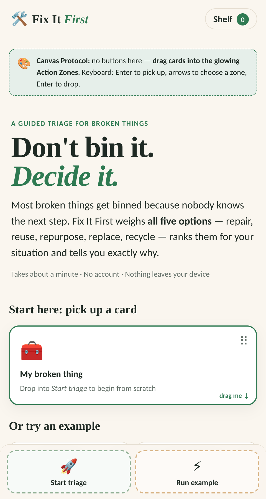
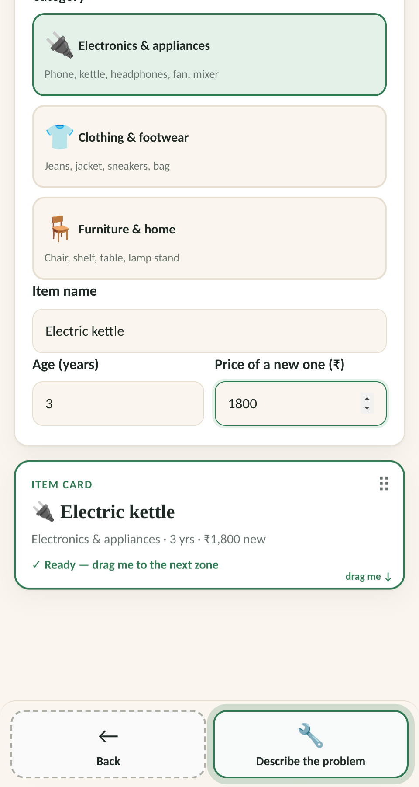
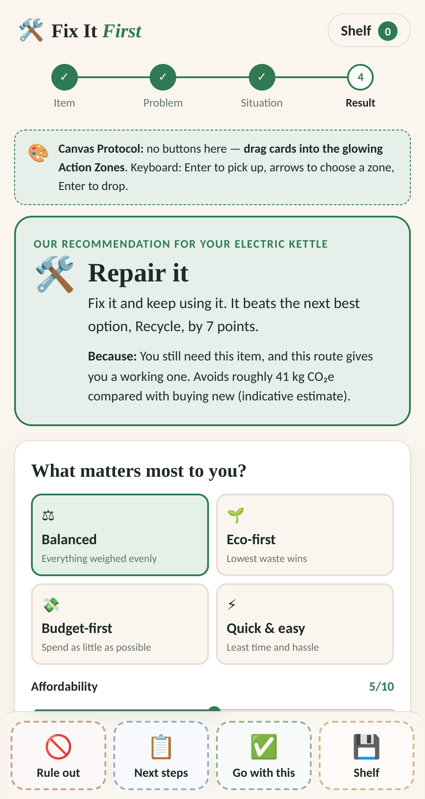
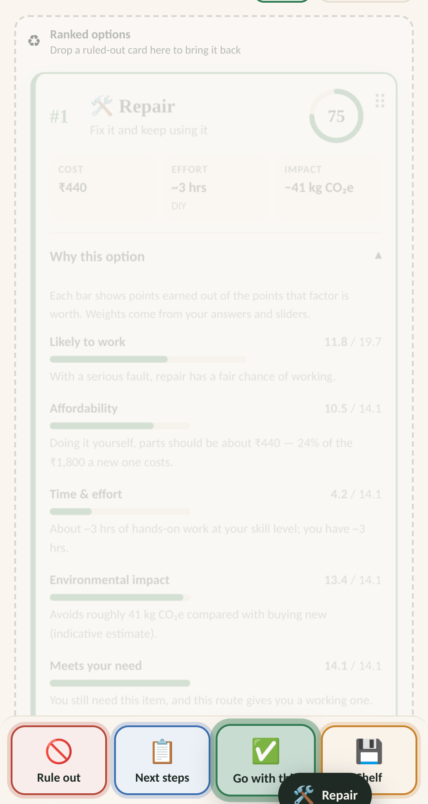
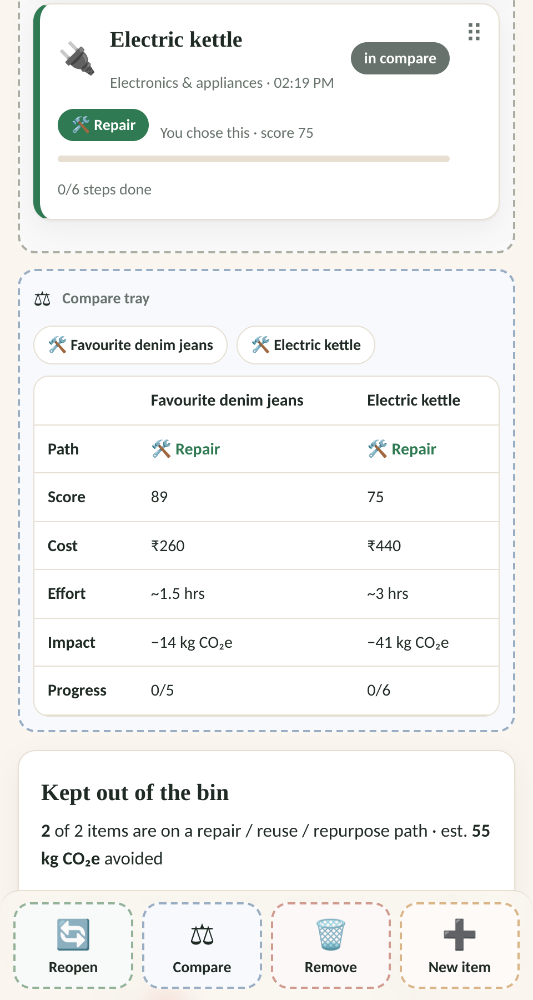
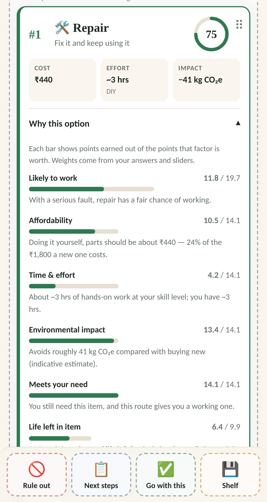

# 🛠️ Fix It First — *Don't bin it. Decide it.*

**Team Variant Fixers · CodeVariant Hackathon 2026 · Round 2 (12-hour build)**

A guided triage for broken things. Instead of "fix it or bin it", Fix It First compares **all five options — Repair, Reuse, Repurpose, Replace, Recycle** — ranks them for *your* situation and explains **exactly why**.

🔗 **Live demo:** `fix-it-first.netlify.app`



---

## 🎯 The problem

Things get binned not because they are useless, but because nobody knows the next step.

| What people see | What actually exists |
|---|---|
| Fix it / Bin it | Repair · Reuse · Repurpose · Replace · Recycle |
| "Buy new" quietly becomes the default | Five real options, each with different cost, effort, safety and impact |

**Success =** the user knows *why* an option fits, not just which one won.

---

## ✨ Features

- **Item & condition input** — category, age, replacement price
- **Symptom cards + free text** — faster than typing, great on mobile
- **Situation questions** — budget, DIY skill, time, whether you still need it, sentimental value
- **Five-option comparison** — score, cost, effort and CO₂ impact for every option
- **"Why this option"** — expandable breakdown of 8 scoring factors with plain-language reasons
- **Never defaults to "buy new"** — Replace is scored like every other option
- **Safety-aware** — electrical and structural faults change what is recommended
- **What-if controls** — 4 modes (Balanced, Eco-first, Budget-first, Quick & easy), importance sliders and a hard budget cap; rankings re-order live
- **Next-step checklist** — concrete actions for each option
- **Session shelf** — save, reopen and compare past items

| Input steps | Ranked results |
|---|---|
|  |  |

---

## 🎨 Surprise Challenge — The Canvas Protocol

> *No standard buttons for primary actions. Users must drag and drop data cards into Action Zones.*

We did not start over — we adapted the same app. **Every primary action is now a drag-and-drop**:

| Screen | Card you drag | Action Zone → what happens |
|---|---|---|
| Landing | My broken thing / Example | **Start triage** · **Run example** |
| Item / Problem / Situation | Live summary card | **Next step** (validates, shakes if incomplete) · **Back** |
| Problem | Symptom cards | **Tray** (add) · **Symptoms** (remove) |
| Results | Option card | **Rule out** · **Next steps** · **Go with this** · **Shelf** |
| Results | Ruled-out chip | Ranked list (**restore**) |
| Option detail | Step cards | **To do** ⇄ **Done** |
| Shelf | Shelf card | **Reopen** · **Compare** · **Remove** · **New item** |



**Built to be usable, not just flashy**
- 🖱️ Mouse, ✋ touch (drag by the ⠿ handle so scrolling still works) and ⌨️ keyboard (Enter = pick up, arrows = choose zone, Enter = drop, Esc = cancel)
- Zones that accept the card you hold **glow**; the rest dim
- Incomplete cards **shake** the zone and say what is missing
- Screen-reader announcements for pick-up and drop



---

## 🧠 How the scoring works

Every option is scored 0–1 on **8 factors**, then combined with weights from the user's answers and sliders:

`Affordability · Time & effort · Environmental impact · Sentimental value · Safety · Likely to work · Meets your need · Life left in item`

Nothing is hidden — each option shows the points earned per factor and a one-line reason.



---

## 🧰 Tech stack

- **React 18 + Vite** (frontend only — no backend)
- Custom **drag-and-drop engine** using Pointer Events (`src/dnd.jsx`) — no external DnD library
- Rules-and-weights **JSON-style config** (`src/config.js`) so new modes or categories need config changes, not new logic
- `sessionStorage` for the shelf and checklist progress
- Plain CSS, mobile-first, light and dark mode, reduced-motion support

---

## 🚀 Run locally

```bash
cd fix-it-first-project/fix-it-first
npm install
npm run dev        # http://localhost:5173
npm run build      # outputs dist/index.html (single self-contained file)
npm test           # scoring-engine and drag-and-drop tests
```

---

## 📁 Project structure

```
fix-it-first-project/fix-it-first/
├── src/
│   ├── config.js          # categories, symptoms, options, factors, modes
│   ├── engine.js          # transparent scoring engine
│   ├── dnd.jsx            # Canvas Protocol: DragCard + ActionZone
│   ├── store.jsx          # state + sessionStorage
│   ├── screens/           # Landing, Item, Problem, Situation, Results, Detail, Shelf
│   └── styles.css
└── scripts/               # engine + drag-and-drop tests
```

---

## 👥 Team

**Variant Fixers** — CodeVariant Hackathon, *Build Different.*

> Estimates for cost, effort and CO₂ are indicative. Always follow safety guidance for electrical items.
